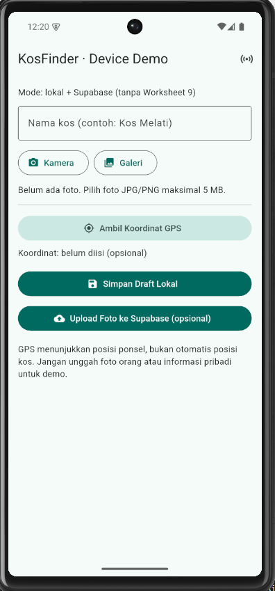
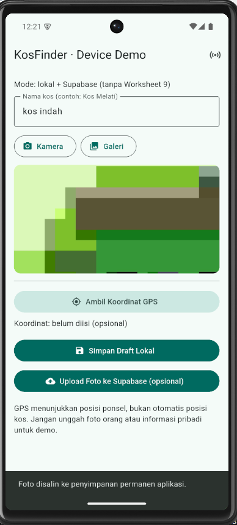
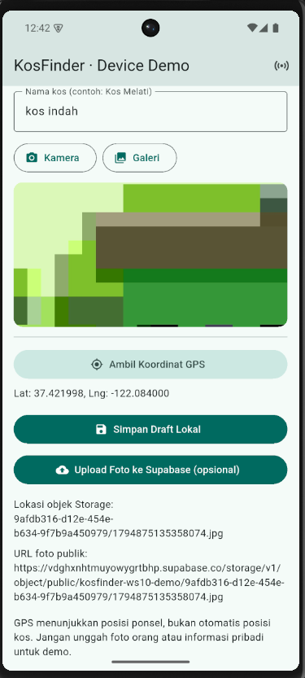
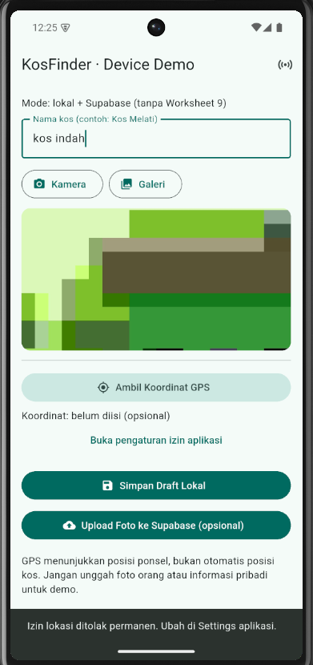
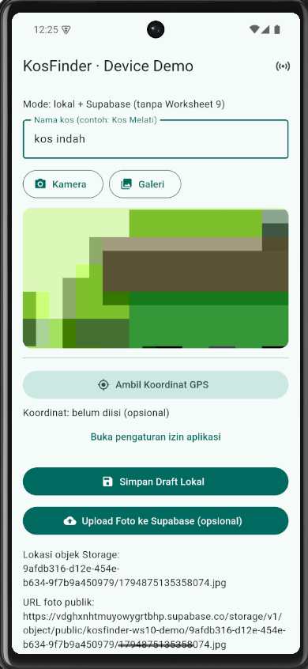
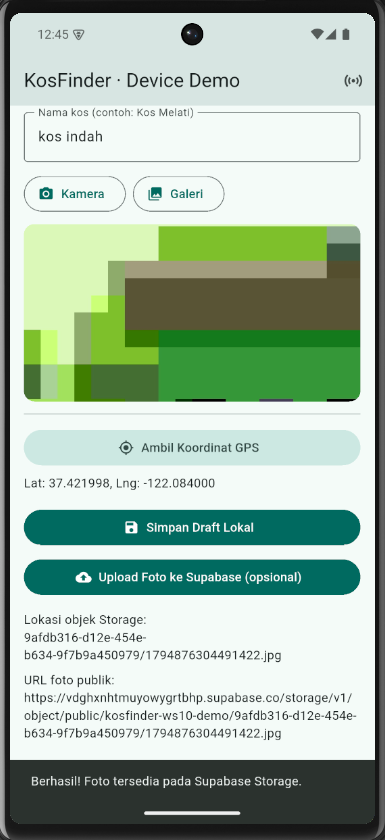
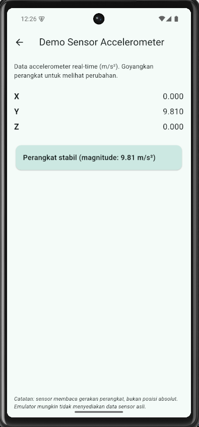

# KosFinder Device Demo (Worksheet 10)

Aplikasi Flutter standalone yang dibuat untuk memenuhi Worksheet 10 - Advanced Mobile Features & Device Integration. Aplikasi ini mendemonstrasikan integrasi perangkat keras (kamera, GPS, sensor) dan penyimpanan data lokal maupun cloud.

## 🚀 Fitur Utama

### Fitur Wajib
- **Kamera & Galeri:** Mengambil foto menggunakan `image_picker` dan menyalinnya secara permanen ke direktori dokumen aplikasi (bukan sekadar cache).
- **GPS & Runtime Permission:** Mengambil koordinat lokasi dengan penanganan izin yang komprehensif (izin ditolak, GPS mati, *timeout*) menggunakan `geolocator`.
- **Draft Lokal:** Menyimpan metadata (nama kos, path foto, koordinat) secara lokal menggunakan `shared_preferences`. Draft tetap ada meskipun aplikasi ditutup atau di-restart.

### Fitur Pengayaan (Opsional)
- **Supabase Storage:** Mengunggah foto ke cloud storage menggunakan *anonymous sign-in* dan *Row Level Security* (RLS) via `supabase_flutter`.
- **Sensor Accelerometer:** Mendemonstrasikan pembacaan data sensor gerak perangkat secara *real-time* menggunakan `sensors_plus`.

## 📸 Bukti Implementasi

| Mode Lokal | Kamera & GPS | Draft Tersimpan |
| :---: | :---: | :---: |
|  |  |  |

| GPS Ditolak | GPS Mati | Upload Supabase | Sensor Accelerometer |
| :---: | :---: | :---: | :---: |
|  |  |  |  |

## 🛠️ Cara Menjalankan

### 1. Mode Lokal (Offline)
Aplikasi berjalan sepenuhnya offline tanpa memerlukan akun atau koneksi ke Supabase.
```bash
flutter pub get
flutter run
